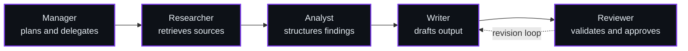

 

  

---

## 01 &nbsp;/&nbsp; Introduction

I am a BS Computer Science student (Artificial Intelligence specialization, 7th semester) at the **University of Engineering & Technology, Mardan, Pakistan**. I build AI systems around language models, retrieval, and multi-agent workflows, and I am developing the engineering habits that move a prototype toward production: testing, validation, and deployment.

My goal is to build practical, reliable AI systems, contribute to meaningful projects, and pursue international AI/ML opportunities.

---

## 02 &nbsp;/&nbsp; Technical Focus

<table>
<tr>
<td width="50%" valign="top">

**🤖 Agentic AI** 
Multi-agent workflows and tool calling with LangGraph and LangChain, with structured hand-offs between agents.

</td>
<td width="50%" valign="top">

**🧠 Generative AI and RAG** 
LLM applications grounded in retrieved knowledge using embeddings and vector stores (FAISS, ChromaDB).

</td>
</tr>
<tr>
<td width="50%" valign="top">

**📈 Machine Learning and Deep Learning** 
Model training and evaluation, feature engineering, and data preprocessing with PyTorch, TensorFlow, and Scikit-learn.

</td>
<td width="50%" valign="top">

**👁️ Computer Vision and NLP** 
Image classification and object detection (OpenCV, YOLOv8), plus text processing pipelines.

</td>
</tr>
</table>

---

## 03 &nbsp;/&nbsp; Skills and Technologies

  

 

<table>
<tr>
<td width="22%" valign="top"><b>Programming</b></td>
<td>

</td>
</tr>
<tr>
<td valign="top"><b>Machine Learning</b></td>
<td>

</td>
</tr>
<tr>
<td valign="top"><b>Generative AI</b></td>
<td>

</td>
</tr>
<tr>
<td valign="top"><b>Agentic AI and RAG</b></td>
<td>

</td>
</tr>
<tr>
<td valign="top"><b>Computer Vision and NLP</b></td>
<td>

</td>
</tr>
<tr>
<td valign="top"><b>Backend and Infrastructure</b></td>
<td>

</td>
</tr>
<tr>
<td valign="top"><b>Data and Tooling</b></td>
<td>

</td>
</tr>
</table>

---

## 04 &nbsp;/&nbsp; GitHub Statistics

 

Cards are generated live by external services. If a card does not load, <a href="https://github.com/faizankhanfreelancer">view the profile directly</a>.

---

## 05 &nbsp;/&nbsp; Featured AI Projects

<table>
<tr>
<td width="50%" valign="top">

### 🌾 AI Crop Advisory System
Agentic advisory system for crop recommendations and agricultural decision-making in Pakistan. A LangGraph agent workflow retrieves domain knowledge through RAG and serves it via a FastAPI backend with a React interface.

**[Explore Repository →](https://github.com/faizankhanfreelancer/REPLACE_WITH_REPO_NAME)**

</td>
<td width="50%" valign="top">

### 🏭 Autonomous AI Workforce
Multi-stage AI workflow with Manager, Researcher, Analyst, Writer, and Reviewer roles, focused on task orchestration, structured collaboration, and workflow validation.

**[Explore Repository →](https://github.com/faizankhanfreelancer/REPLACE_WITH_REPO_NAME)**

</td>
</tr>
<tr>
<td width="50%" valign="top">

### 🤝 Multi-Agent Collaborative AI
Exploration of coordinated agents and collaborative task execution.

**[Explore Repository →](https://github.com/faizankhanfreelancer/REPLACE_WITH_REPO_NAME)**

</td>
<td width="50%" valign="top">

### 📦 ProcurAI
AI-driven procurement project. <!-- REPLACE: add one confirmed sentence about what it does -->

<!-- REPLACE: add confirmed technology badges -->

**[Explore Repository →](https://github.com/faizankhanfreelancer/REPLACE_WITH_REPO_NAME)**

</td>
</tr>
<tr>
<td width="50%" valign="top">

### 💬 SupportAI
AI customer-support assistant. <!-- REPLACE: add one confirmed sentence about what it does -->

<!-- REPLACE: add confirmed technology badges -->

**[Explore Repository →](https://github.com/faizankhanfreelancer/REPLACE_WITH_REPO_NAME)**

</td>
<td width="50%" valign="top">

 
More work is available on my <a href="https://github.com/faizankhanfreelancer?tab=repositories">repositories page</a> and my <a href="https://faizankhan-visit-my-portfolio.vercel.app">portfolio</a>.

</td>
</tr>
</table>

---

## 06 &nbsp;/&nbsp; Agentic AI Workflow

A representative multi-agent pattern. Individual projects use variations of it, not necessarily every stage.

---

## 07 &nbsp;/&nbsp; Current Focus

<table>
<tr>
<td width="50%" valign="top">

**Learning**
- Advanced agentic AI and agent orchestration
- LLM application development
- AI system deployment
- Production-ready ML workflows

</td>
<td width="50%" valign="top">

**Engineering goals**
- Testing and evaluating agent workflows
- Reliable, deployable AI applications
- Open-source collaboration on AI projects
- Research-oriented work, including my final year project

</td>
</tr>
</table>

---

## 08 &nbsp;/&nbsp; Contribution Activity

  

Graph not loading?

 
Contribution history is available directly on my <a href="https://github.com/faizankhanfreelancer">GitHub profile</a>.

---

## 09 &nbsp;/&nbsp; Connect

I am open to collaboration on AI projects and to conversations about Machine Learning and Generative AI roles.

 

  

